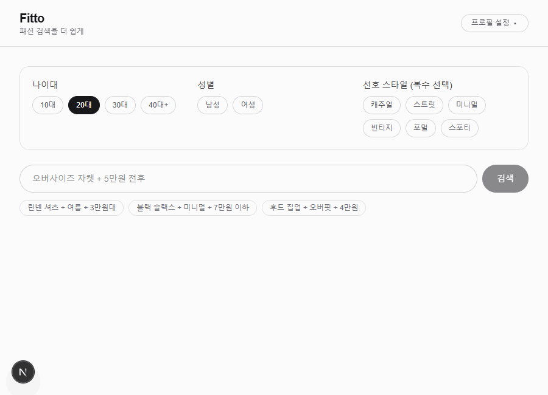
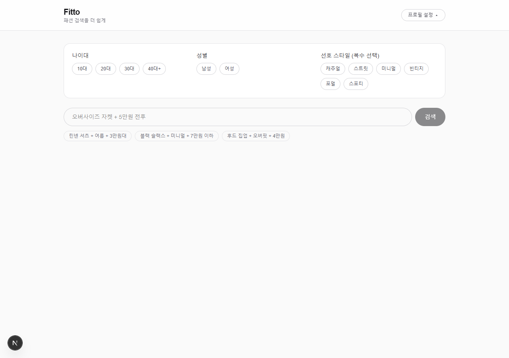
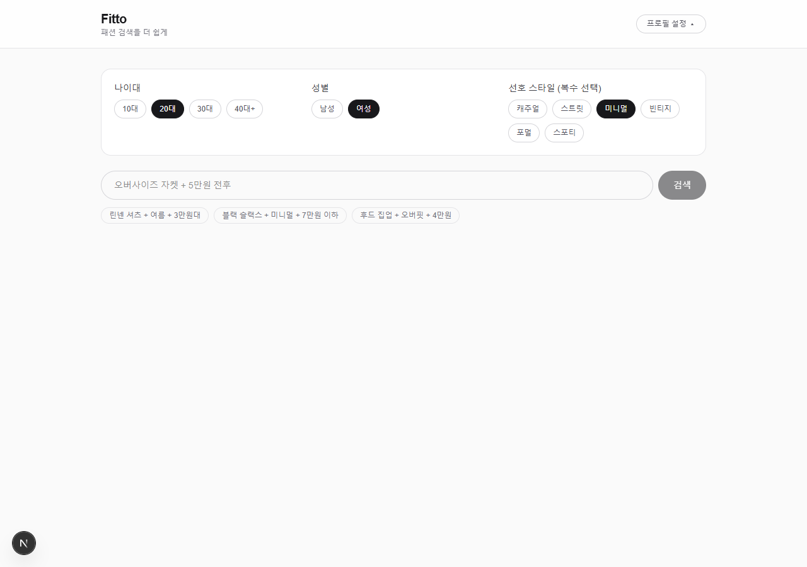
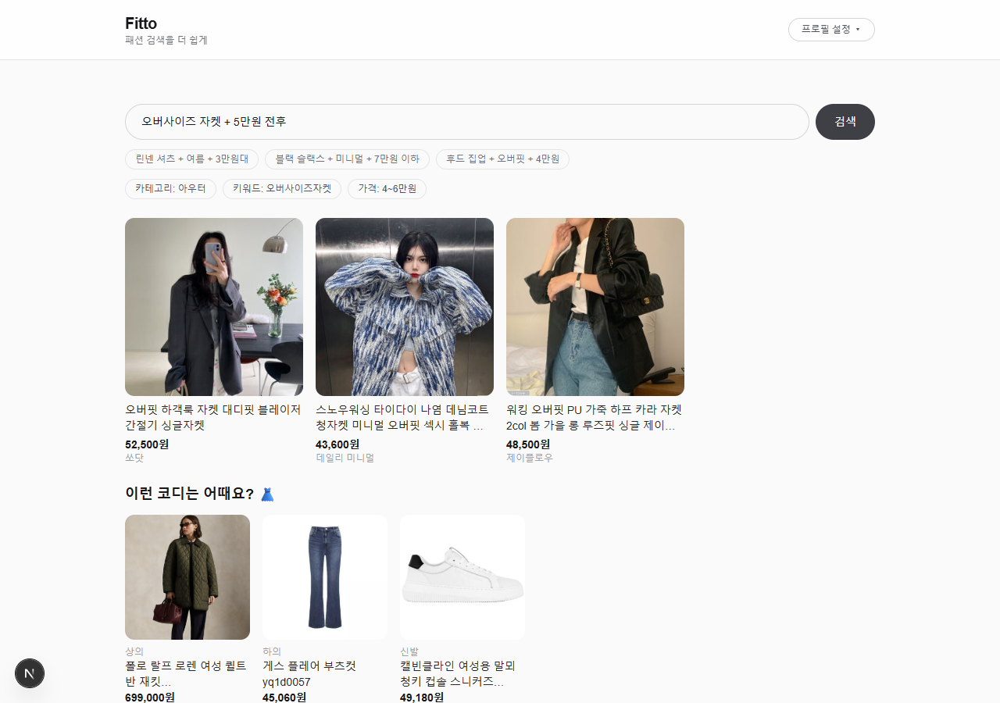
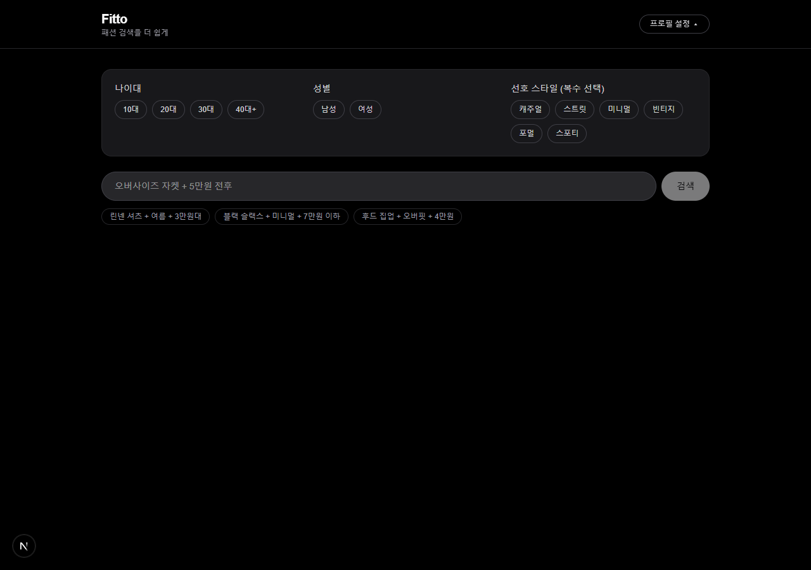

# Fitto

**패션 검색을 더 쉽게.** 자연어 한 문장으로 원하는 옷을 찾고, AI가 어울리는 코디까지 추천해주는 패션 검색 서비스입니다.

> "오버사이즈 자켓 + 5만원 전후" 라고 검색하면, 조건에 맞는 상품과 함께 어울리는 하의·신발·아우터까지 한 번에 추천받을 수 있어요.

## 실제 동작 예시

프로필 설정 → 자연어 검색 → 결과 + 코디 추천까지 이어지는 전체 흐름입니다.



## 스크린샷

| 첫 방문 (프로필 설정) | 프로필 입력 |
| --- | --- |
|  |  |

| 검색 결과 + 코디 추천 | 다크 모드 |
| --- | --- |
|  |  |

## 주요 기능

### 🗣️ 자연어 검색
"린넨 셔츠 + 여름 + 3만원대" 처럼 말하듯이 입력하면 Claude가 검색 의도를 분석해 **키워드 / 가격 범위 / 카테고리**로 구조화합니다.

- 가격 표현을 자동으로 해석합니다.
  - `N만원 전후` → `N-1`~`N+1`만원
  - `N만원대` → `N0000`~`N9999`원
  - 수식어 없는 `N만원` → `N`만원의 ±10%
  - `~이하` / `~이상` 등도 문맥에 맞게 변환
- `+` 기호나 가격 관련 단어는 검색 키워드에서 자동으로 제거됩니다.

### 🚫 패션 카테고리 검증
전자기기, 식품처럼 패션과 무관한 검색은 걸러내고, 상의·하의·아우터·신발·가방·원피스·모자·머플러 등 **실제 패션 아이템만** 검색이 이루어지도록 1차 필터링합니다. 목록에 없는 세부 품목(하이힐, 블레이저 등)도 대분류로 일반화해 인식합니다.

### 👗 AI 코디 추천
검색 결과가 있으면, 검색한 아이템의 카테고리를 분석해 **겹치지 않는 나머지 아이템**을 추천합니다.

- 상의를 검색하면 → 하의 · 신발 · 아우터 추천
- 하의를 검색하면 → 상의 · 신발 · 아우터 추천
- 원피스를 검색하면 → 신발 · 아우터만 추천 (이미 상/하의를 겸함)
- 모자·머플러처럼 곁들이는 아이템을 검색하면 → 상의·하의·아우터·신발 풀 코디 추천

### 👤 프로필 기반 개인화
나이대 / 성별 / 선호 스타일(복수 선택)을 설정하면 검색어 해석과 코디 추천에 반영됩니다. 프로필은 브라우저 `localStorage`에 저장되어 새로고침해도 유지됩니다.

### 🎨 반응형 · 다크 모드
모바일 2열 / 태블릿 3열 / 데스크탑 4열 그리드로 반응형 레이아웃을 제공하며, 시스템 다크 모드를 자동으로 지원합니다.

## 동작 흐름

```
사용자 입력
   │
   ▼
[POST /api/parse]  Claude(claude-sonnet-5)로 자연어 → { keywords, priceMin, priceMax, categories, isFashion }
   │
   ├── isFashion === false ──▶ "패션 아이템만 검색할 수 있어요!" 안내
   │
   ▼
[POST /api/search]  SerpApi(네이버 쇼핑)로 상품 검색 + 가격 필터링
   │
   ▼
검색 결과 1개 이상
   │
   ▼
[POST /api/recommend]  카테고리별 코디 키워드 생성(Claude) → 항목별 /api/search 재호출 → 상품 1개씩 반환
```

## 한계 및 개선 방향

- **프로필 기반 개인화의 한계**: 네이버 쇼핑(SerpApi) 검색 API 자체에는 사용자 프로필 기반 개인화 랭킹 기능이 없습니다. 현재는 성별·나이대·선호 스타일 중 첫 항목을 검색어에 추가 키워드로 덧붙이는 방식으로 구현돼 있어, 검색어가 이미 구체적인 경우(예: "블랙 슬랙스")에는 프로필에 따른 결과 차이가 크지 않을 수 있습니다.
- **SerpApi 무료 요금제 한도**: Free Plan 기준 월 250건으로 제한됩니다. 검색 1회당 파싱(Claude) + 검색(SerpApi) 최소 2회 호출이 발생하고, 코디 추천까지 이어지면 카테고리별로 최대 3~4회의 SerpApi 호출이 추가돼 한도 소진이 예상보다 빠를 수 있습니다.
- **정량적 검증 부재**: 검색 정확도나 가격 적중률 같은 정량 지표는 아직 별도로 측정하지 않았습니다. 실사용 로그를 기반으로 한 벤치마크는 향후 과제입니다.
- **응답 지연**: 검색 1회에 Claude 호출과 SerpApi 호출이 순차적으로 이어져, 특히 코디 추천까지 포함되면 응답까지 수 초가 걸릴 수 있습니다.

### 향후 개선 방향
- 무신사 / 29CM 등 실제 쇼핑몰 API 직접 연동 시 검색 정확도와 프로필 기반 개인화 수준을 함께 끌어올릴 수 있습니다.
- 실사용 로그를 기반으로 Before/After 비교, 정확도 지표를 수집해 정량적으로 검증할 계획입니다.

## 기술 스택

- **Framework**: Next.js 16 (App Router, Turbopack)
- **UI**: React 19, TypeScript, Tailwind CSS v4
- **AI**: [Claude API](https://platform.claude.com) (`@anthropic-ai/sdk`) — 자연어 파싱 & 코디 추천, JSON Schema 기반 구조화 출력(`output_config`) 사용
- **상품 검색**: [SerpApi](https://serpapi.com) 네이버 쇼핑 엔진

## 프로젝트 구조

```
app/
├── page.tsx                # 메인 검색 UI
├── api/
│   ├── parse/route.ts      # 자연어 → 구조화 검색 조건 (Claude)
│   ├── search/route.ts     # 상품 검색 (SerpApi)
│   └── recommend/route.ts  # 코디 추천 (Claude + 검색 재호출)
components/
├── ProfileSetup.tsx         # 프로필 설정 패널
├── SearchBar.tsx            # 자연어 검색창
├── ParsedBadges.tsx         # 파싱 결과 뱃지
├── ProductGrid.tsx          # 상품 그리드
└── RecommendSection.tsx     # 코디 추천 섹션
lib/
├── anthropic.ts             # Claude 클라이언트 & 모델 설정
└── types.ts                 # 공용 타입 정의
```
